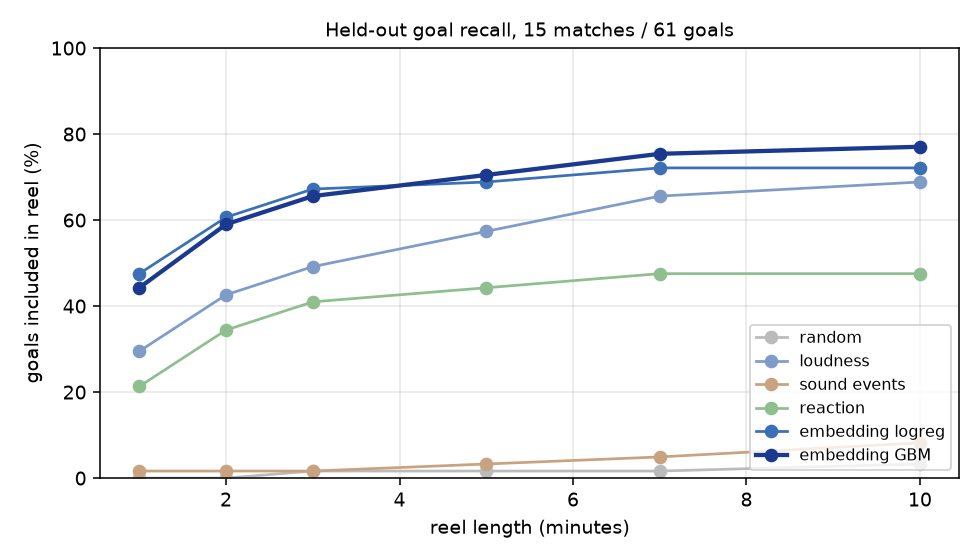
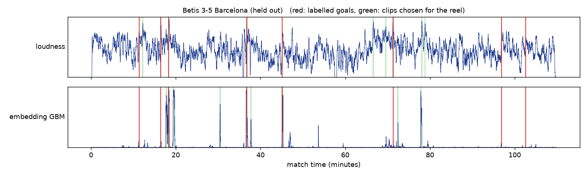

# matchreel

**Automatic football highlights from broadcast audio, evaluated on 15 held-out matches.**

matchreel listens to a full match, scores every half-second for "is a goal happening here?", and cuts the top moments into a highlight reel of any length. The best model is a gradient-boosted classifier on **PANNs CNN14 audio embeddings**. In a 3-minute reel it captures **66% of goals versus 49% for crowd loudness**, on matches it was never trained on.



## Results

**Data:** 15 full LaLiga broadcasts (26.8 hours of audio, 61 goals).
**Protocol:** leave-one-match-out. Every model is trained on 14 matches and scored on the 15th, which it has never seen, and this is rotated through all 15.

| Scorer | ROC-AUC | Avg. precision | Goals in 3-min reel | Goals in 5-min reel |
|---|---:|---:|---:|---:|
| Random | 0.49 | 0.01 | 1 / 61 | 1 / 61 |
| Pretrained sound events (AudioSet "cheering", "crowd"…) | 0.54 | 0.02 | 1 / 61 | 2 / 61 |
| Crowd loudness | 0.81 | 0.20 | 30 / 61 (49%) | 35 / 61 (57%) |
| Reaction (loudest point in the next 15 s) | 0.89 | 0.22 | 25 / 61 | 27 / 61 |
| **Embedding logistic regression** | 0.93 | 0.45 | **41 / 61 (67%)** | 42 / 61 (69%) |
| **Embedding gradient boosting** | **0.94** | **0.50** | 40 / 61 (66%) | **43 / 61 (70%)** |

ROC-AUC and average precision rank every half-second frame (positive = within ±10 s of a goal). Goal recall counts goals whose moment is inside the generated reel.

**Is the improvement real?** Paired bootstrap over matches (5000 resamples, 95% CI) of embedding GBM minus loudness:

| Metric | Difference | 95% CI |
|---|---:|---|
| Average precision | +0.30 | [+0.23, +0.36] |
| ROC-AUC | +0.13 | [+0.10, +0.16] |
| Goal recall, 3-min reel | +0.16 | [+0.02, +0.30] |
| Goal recall, 5-min reel | +0.13 | [−0.02, +0.26] (not significant) |

Full tables: [`results/v2/summary.csv`](results/v2/summary.csv), [`results/v2/bootstrap.csv`](results/v2/bootstrap.csv), per match: [`results/v2/per_match.csv`](results/v2/per_match.csv).


*Betis 3–5 Barcelona, scored by a model that never saw it. Red = goals, green = clips chosen for a 3-minute reel.*

### What we learned

- **Generic sound-event classes don't transfer to broadcasts.** AudioSet's "cheering" and "crowd" probabilities are near chance, because a stadium is *always* a crowd. But the **same network's 2048-d embedding**, reduced to 32 principal components and given a classifier, more than doubles average precision over loudness. The useful information is in the representation, not in the label set it was trained for.
- **The crowd reacts after the goal.** Loudness over the *next* 15 s (AUC 0.89) is a far better feature than loudness at that moment (0.64 in the pilot). Every model gets look-ahead context, which is valid because highlights are cut offline.
- **Few features beat many when data is scarce.** In the 3-match pilot (below), a 30-feature model overfit and lost to a single feature. With 15 matches, the learned models win clearly.
- **Limits.** One club's broadcasts (Barcelona, LaLiga), goals only (no saves, chances or cards), and differences of a few goals are within noise at long reel lengths.

## Ground truth without listening: reading the scoreboard

The models only see audio, so the labels come from the video:

1. **Hand-verified pilot:** the 18 goals of 3 matches were located frame by frame (`tools/contact_sheet.py`).
2. **Automatic labels for the rest** (`tools/scoreboard_auto.py`):
   - read the score digits of the broadcast graphic once per second, using shift-tolerant glyph templates built from the pilot
   - accept a goal only when the score goes up by exactly one and stays there
   - subtract the scoreboard delay, measured on the 14 pilot goals with this graphic (median 4.5 s)
3. **Validation gate:** a match is used only if the reading reproduces the final score in the video title for both teams. 12 of 14 matches passed. Two were rejected and left out rather than patched: one where the graphic was rarely detected, and one with a phantom read. [`meta/label_status.csv`](meta/label_status.csv)

## Pipeline

```
audio ─┬─ loudness: RMS dB, robust z-score, rise vs. previous 10 s
       ├─ PANNs CNN14 (AudioSet) on 2 s windows: 6 class probabilities + 2048-d embedding
       └─ (pilot only) Whisper commentary: excitement phrases, speech rate
          │
          ├─ embedding -> PCA(32), fitted on training matches only
          ├─ context features: max over the next 15 s, mean over ±5 s
          ├─ classifier (logistic regression / gradient boosting, fixed hyper-parameters)
          └─ peak picking (≥30 s apart) -> clips [peak−12 s, peak+8 s] -> merge -> fit reel budget -> ffmpeg
```

## Usage

```bash
pip install -e ".[models,app,dev]"

python -m matchreel run match.mp4 --budget 300 --out reel.mp4      # learned model (models/embedding_gbm.joblib)
python -m matchreel run match.mp4 --scorer loudness                 # no ML baseline
python tools/process_match.py m04                                   # auto-label + features for a manifest match
python experiments/benchmark_v2.py                                  # leave-one-match-out benchmark + bootstrap
python experiments/make_figures.py                                  # figures + demo reel from held-out scores
streamlit run app.py                                                # upload a match, get a reel
pytest                                                              # 8 tests on synthetic data
```

## Data

The matches are FC Barcelona's official YouTube full-match uploads, listed in [`meta/matches.csv`](meta/matches.csv). Videos and audio are not redistributed. The repository contains the goal labels, the per-frame held-out scores of every model ([`results/v2/scores/`](results/v2/scores)) and all result tables, so every number above can be re-checked without the media. Processing from scratch takes about 25 min per match on a laptop CPU.

## Pilot (3 matches, hand labels)

The first version used 3 matches and added Whisper commentary features. There, the best scorer was simply loudness over the next 15 s (AUC 0.92), and a 30-feature model overfit. Those results ([`results/benchmark_full.csv`](results/benchmark_full.csv)) motivated scaling the data before trusting any learned model.

## Credits

The idea that crowd noise marks a match's best moments was inspired by a highlights script by IIT Bombay seniors Sufiyan and Syed. matchreel is an independent implementation. Pretrained models: [PANNs](https://github.com/qiuqiangkong/panns_inference) (Kong et al., 2020) and [Whisper](https://github.com/openai/whisper) (Radford et al., 2022).
