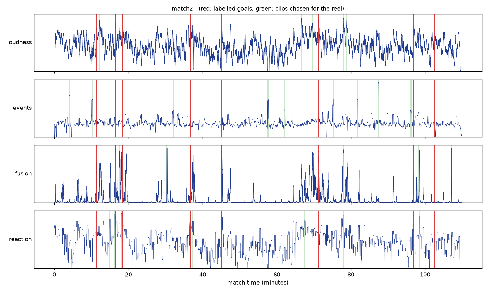

# matchreel

**Automatic football highlights from match audio, evaluated against hand-verified goal times.**

matchreel listens to a full broadcast, scores every half-second for "excitement", and cuts the top moments into a highlight reel of any length. It compares four scoring approaches (crowd loudness, a pretrained AudioSet sound-event model, commentary transcription, and learned combinations of them) on held-out matches.


*Betis 3–5 Barcelona: red lines = the 8 goals, green = clips each scorer chose for a 3-minute reel.*

## Results

3 full LaLiga broadcasts (5.3 hours, 18 goals), **leave-one-match-out**: every learned scorer is evaluated only on a match it never saw.

| Scorer | ROC-AUC | Avg. precision | Goals in a 3-min reel | Goals in a 10-min reel |
|---|---:|---:|---:|---:|
| Random | 0.51 | 0.02 | 1 / 18 | 2 / 18 |
| Loudness (crowd volume) | 0.76 | 0.19 | 9 / 18 | **14 / 18** |
| Sound events (PANNs CNN14, AudioSet) | 0.59 | 0.04 | 1 / 18 | 1 / 18 |
| Fusion (logistic regression, 30 features) | 0.87 | 0.26 | 7 / 18 | 13 / 18 |
| **Reaction (best signal, chosen on training matches)** | **0.92** | **0.30** | **10 / 18** | 10 / 18 |

ROC-AUC and average precision measure how well each half-second frame is ranked (a frame is positive if it lies within ±10 s of a goal). Goal recall counts goals whose moment falls inside the generated reel. Full tables: [`results/benchmark_full.csv`](results/benchmark_full.csv), per-signal ablation: [`results/signal_auc.csv`](results/signal_auc.csv).

**What we learned**

- **The crowd reacts *after* the goal.** The single most predictive signal is the loudest moment in the *next* 15 seconds (AUC 0.92), not the loudness at the moment itself (0.64). Selected independently on each training split, it was the same feature every time.
- **More features overfit.** With only two training matches per split, the 30-feature fusion model ranks frames better than raw loudness but loses to the single "reaction" feature.
- **A generic pretrained audio tagger is not enough.** PANNs' cheering/crowd probabilities barely beat chance on broadcast audio, where commentary and constant crowd noise dominate. Its "shout" class is its most useful output (AUC 0.75).
- **Limits.** 3 matches and 18 goals is a small sample; differences of 1–2 goals are within noise. Goal-recall rankings change with reel length (loudness wins at 10 min, reaction at 3 min).

## How the labels were made (independently of the audio)

The models only ever see the audio, so the ground truth comes from the video:

1. `tools/scoreboard_goals.py` reads the on-screen score with OCR (EasyOCR) every 2 s and finds when it changes.
2. Each goal's exact moment (ball crossing the line) was then confirmed by eye on frame contact sheets from `tools/contact_sheet.py`, since broadcasters update the score a few seconds late. Every final score matched.

Labels: [`labels/`](labels). Features computed from the audio: [`cache/`](cache).

## Pipeline

```
audio ─┬─ loudness: RMS dB, robust z-score, rise vs. previous 10 s
       ├─ sound events: PANNs CNN14 on 2 s windows -> cheer / crowd / shout / whistle / music / speech
       └─ commentary: Whisper base.en transcript -> excitement-phrase score, words per second
          │
          ├─ context features: max over the next 15 s, mean over ±5 s
          ├─ scorer -> excitement curve
          └─ peak picking (≥30 s apart) -> clips [peak−12 s, peak+8 s] -> merge -> fit reel budget -> ffmpeg render
```

## Usage

```bash
pip install -e ".[models,app,dev]"

python -m matchreel features match.mp4                     # compute and cache all signals
python -m matchreel run match.mp4 --budget 300 --scorer loudness --out reel.mp4
python -m matchreel labels labels/match1.events.csv         # time,type,note -> label files
python -m matchreel benchmark data/match*.m4a --budget 180  # leave-one-match-out comparison
python -m matchreel plot data/match*.m4a                    # excitement curves
streamlit run app.py                                         # upload a match, get a reel
pytest                                                       # 7 tests on synthetic audio
```

## Reproducing the results

The videos aren't redistributed. The matches are official FC Barcelona YouTube uploads:

| | Match | YouTube ID |
|---|---|---|
| match1 | Real Madrid 0–4 Barcelona (2015) | `QS3IEsVgUKs` |
| match2 | Betis 3–5 Barcelona (2025/26) | `93LPZJkCW2w` |
| match3 | Barcelona 6–0 Valencia (2025/26) | `ymCoJm9RXbY` |

With the committed `cache/` and `labels/`, `python -m matchreel benchmark data/match1.m4a data/match2.m4a data/match3.m4a --budget 180` reproduces the table without downloading anything (only the file names are used to find cached features). Feature extraction from scratch takes about 15–18 min per match on a laptop CPU.

## Credits

The idea that crowd noise marks a match's best moments was inspired by a highlights script by IIT Bombay seniors Sufiyan and Syed. matchreel is an independent implementation. Pretrained models: [PANNs](https://github.com/qiuqiangkong/panns_inference) (Kong et al., 2020) and [Whisper](https://github.com/openai/whisper) (Radford et al., 2022).
